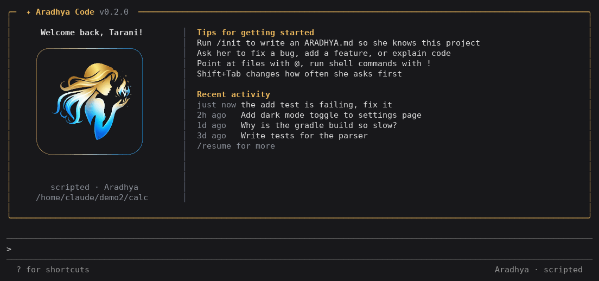
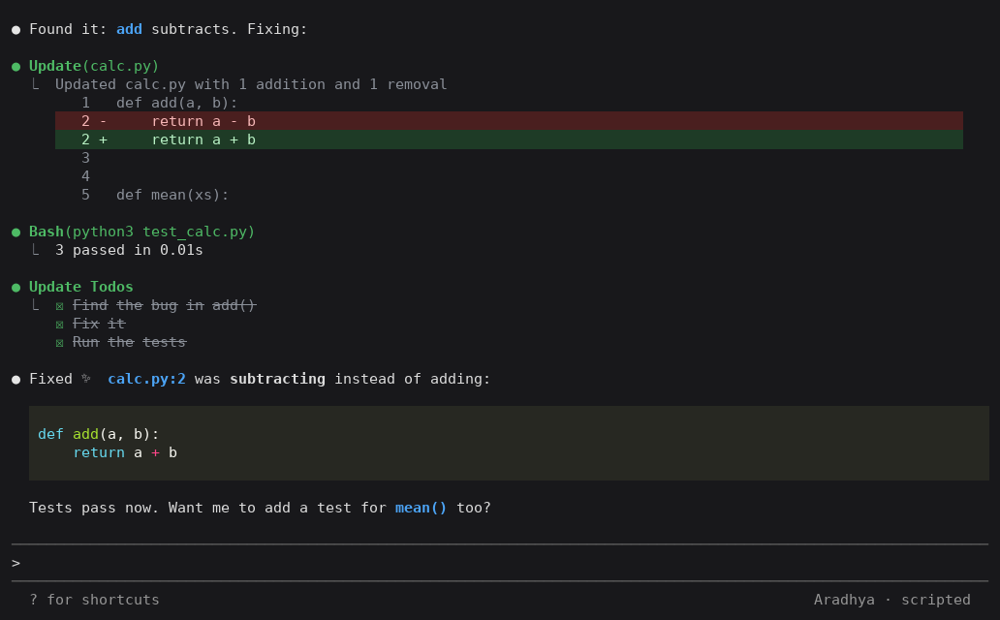
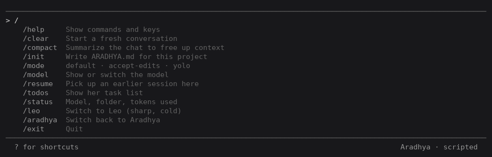
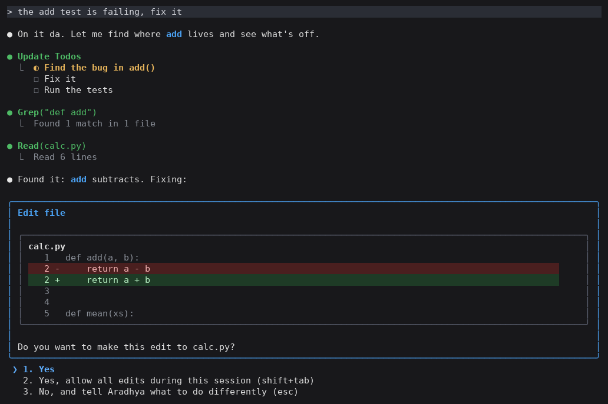

<p align="center"></p>

<h1 align="center">Aradhya Code</h1>

<p align="center"><b>Aradhya, a coding agent in your terminal.</b><br>
<a href="https://taranidhran1206-a11y.github.io/unknown-project/">Website</a> · <a href="#install">Install</a> · <a href="#commands">Commands</a></p>


Aradhya as a coding agent in your terminal. You tell her what you want in plain words. She reads your project, edits files (showing you the change first), runs commands and tests, keeps a to-do list while she works, and remembers each project's notes. It works on Windows, Linux, macOS, your EC2 server and Termux on Android.



## Contents

- [Install](#install)
- [Setting her up](#setting-her-up)
- [Signing in with Google](#signing-in-with-google)
- [Using her](#using-her)
- [Commands](#commands)
- [Keys](#keys)
- [How careful she is](#how-careful-she-is)
- [What she can do](#what-she-can-do)
- [Her soul, memory and skills](#her-soul-memory-and-skills)
- [Project memory: ARADHYA.md](#project-memory-aradhyamd)
- [Sessions](#sessions)
- [Brains she can use](#brains-she-can-use)
- [Her logo in different terminals](#her-logo-in-different-terminals)
- [Symbols and text](#symbols-and-text)
- [Settings](#settings)
- [Troubleshooting](#troubleshooting)

## Install

**Windows** (PowerShell):

```powershell
irm https://raw.githubusercontent.com/taranidhran1206-a11y/unknown-project/main/docs/install.ps1 | iex
```

**macOS, Linux and Termux**:

```bash
curl -fsSL https://raw.githubusercontent.com/taranidhran1206-a11y/unknown-project/main/docs/install.sh | sh
```

That's it. The installer:
- checks for Python 3.9+ (on Windows it offers to install it with winget; on Termux it installs it with `pkg`),
- installs Aradhya Code into its own folder, `~/.aradhya/venv`, so your other Python projects are untouched,
- puts the `ara` command on your PATH,
- starts setup at the end, where you pick her brain and sign in (see below).

Run the same command again to **update**. To **uninstall**, run it with `ARA_UNINSTALL=1`:

```bash
curl -fsSL https://raw.githubusercontent.com/taranidhran1206-a11y/unknown-project/main/docs/install.sh | ARA_UNINSTALL=1 sh
```
```powershell
$env:ARA_UNINSTALL=1; irm https://raw.githubusercontent.com/taranidhran1206-a11y/unknown-project/main/docs/install.ps1 | iex
```

**With pip instead** (any OS): `pip install "aradhya-code[full] @ https://github.com/taranidhran1206-a11y/unknown-project/archive/refs/heads/main.zip"`. On Termux leave out `[full]`: the Gemini SDK can't build on Android, and Aradhya Code talks to Gemini directly without it.

## Setting her up

The first time you run `ara` (or right after the installer), she sets herself up. It takes about a minute:

1. **You**: what she should call you.
2. **Brain**: which AI she thinks with. Pick from a list: sign in with your browser (Google, OpenRouter), paste a key (Gemini, OpenAI, Anthropic, Nous Portal, Groq, DeepSeek, xAI, Mistral), or use a model on your own machine or server (Ollama, LM Studio, Hermes Agent, any OpenAI-compatible address). Ones already running or connected are marked.
3. **Connect**: she signs you in, or takes the key and checks it works. Keys and sign-ins are saved in `~/.aradhya/auth.json`, which only you can read.
4. **Model**: she lists the models that brain actually has, best coding model first. Type to search long lists.
5. **Check**: she says hello with that model, so you know it works before you start.
6. **Careful**: whether she asks before editing files and running commands.

`Esc` goes back a step and `Ctrl+C` stops. Change any of it later:

```bash
ara setup            # everything again
ara model            # another brain or model (/model does this inside a session)
ara login            # sign in or add a key: ara login google, ara login openrouter, ara login anthropic…
ara logout           # remove a saved key or sign-in
ara auth             # what she's connected to
ara doctor           # check Python, packages, the connection and the terminal, with fixes
```

On a server over SSH (like EC2) there's no browser, so she prints the sign-in address instead. Open it on your phone or computer, sign in, and paste back what you get.

If you set her up before this existed, she keeps using your `GEMINI_API_KEY` from `~/.aradhya/.env` and doesn't make you do anything.

## Signing in with Google

Google only lets an app sign you in through its own OAuth client, so this needs a one-time setup in Google Cloud (free, about 3 minutes):

1. In [console.cloud.google.com](https://console.cloud.google.com), make a project and turn on the **Generative Language API**.
2. In **Google Auth platform**, set the audience to **External** and add your Google account (and anyone else who'll use her) under **Test users**.
3. In **Clients**, create a client of type **Desktop app** and download its JSON file.
4. Run `ara login google --client path/to/client_secret.json`.

After that, `ara login google` (or picking Google Gemini in setup) opens Google in your browser, you pick your account, and she's connected. No key to copy. Google's [OAuth guide for the Gemini API](https://ai.google.dev/gemini-api/docs/oauth) has screenshots of each step.

While the client is in "Testing" mode, Google ends sign-ins after 7 days and only test users can sign in; publish it in the Google Auth platform to stop that. A Desktop app's client secret isn't really secret (Google says so for installed apps), so a client file can ship with the app for everyone who installs it.

## Using her

Go to a project folder and start her:

```bash
cd my-project
ara                                   # start a session
ara "the login test is failing, fix it"   # start with a request
ara -p "explain what this repo does"  # answer once and exit (good for scripts)
ara -c                                # continue the last session in this folder
ara -r                                # pick an earlier session to resume
```

Then talk to her normally. A typical session looks like this:



Every action she takes shows as a line with a dot (`● Read(calc.py)`, `● Bash(npm test)`), and its result appears under it after `⎿`. Edits show the exact lines added (green) and removed (red). When she's done, she gives a short summary.

**Pointing at files.** Type `@` and start typing a filename to pick it from a list, for example `explain @src/app.py`.

**Running a command yourself.** Start the line with `!`, for example `!git status`. The input line turns pink and the command runs straight away. She sees the output too, so you can follow up with "why is that failing?".

## Commands

Type `/` to see this list with descriptions:



| Command | What it does |
|---|---|
| `/help` | Commands and keys |
| `/init` | Explores the project and writes `ARADHYA.md` so she understands it next time |
| `/clear` | Starts a fresh conversation (the old one stays saved) |
| `/compact` | Summarizes a long conversation to free up space (she also does this by herself when it gets very long) |
| `/mode` | Changes how careful she is: `default`, `accept-edits` or `yolo` |
| `/model` | Picks another model or brain from a list, or switches straight away: `/model gemini-3.8-flash` |
| `/skills` | Her skills; `/<skill-name>` runs one, e.g. `/code-review my branch` |
| `/learn` | Saves how she just did something as a skill: `/learn`, or `/learn the deploy steps` |
| `/memory` | What she remembers about you and your setup |
| `/soul` | Her personality file; `/soul edit` opens it |
| `/resume` | Picks up an earlier session in this folder |
| `/todos` | Shows her current task list |
| `/status` | Folder, model, mode and tokens used |
| `/leo`, `/aradhya` | Switches persona: Leo is short, sharp and cold; Aradhya is warm |
| `/exit` | Quits (so does Ctrl+C twice, or Ctrl+D) |

## Keys

| Key | What it does |
|---|---|
| Enter | Send |
| Alt+Enter (or Esc then Enter) | New line in your message |
| Shift+Tab | Changes how careful she is (see below) |
| Esc | Stops her mid-answer, then you can redirect her |
| Ctrl+C | Clears what you've typed; press twice on an empty line to quit |
| `?` on an empty line | Shows the shortcuts |
| `@` | File picker |
| `!` at the start of a line | Run a shell command yourself |
| ↑ / ↓ | Your earlier messages |

## How careful she is

She never changes anything without asking unless you tell her she can. Before an edit she shows the change and waits:



Pick with the arrow keys and Enter, or press 1, 2 or 3:

1. **Yes**: do it this once.
2. **Yes, and don't ask again**: for edits, she stops asking for the rest of the session. For a command like `npm test`, she stops asking about `npm test` only.
3. **No**: she stops. Type what she should do instead, or just press Enter to stop her.

Reading files, searching and read-only commands (`ls`, `git status`, `git diff`, `cat`, `grep`…) never ask.

Shift+Tab (or `/mode`) switches between three modes. The current one shows under the input box.

| Mode | She asks before… |
|---|---|
| `default` | every edit and every command that changes something |
| `accept-edits` | commands only (file edits just happen) |
| `yolo` | nothing. Use this only in a project with git, so you can undo. |

You can also start in a mode: `ara --accept-edits` or `ara --yolo`.

## What she can do

| Tool | Shown as | Notes |
|---|---|---|
| Read a file | `Read(path)` | Reads before every edit, and refuses to edit a file she hasn't read |
| Edit a file | `Update(path)` | Replaces exact text, so it can't silently change the wrong place |
| Write a file | `Write(path)` | New files, or a full rewrite of one she has read |
| Find files | `Search(pattern)` | e.g. `**/*.py`, newest first |
| Search contents | `Grep("text")` | Uses ripgrep if installed |
| Run commands | `Bash(command)` | bash on Linux, macOS and Termux; PowerShell on Windows. `cd` carries over between commands. Stops after 2 minutes unless she asks for longer |
| Fetch a web page | `Fetch(url)` | Docs, raw files from GitHub, etc. |
| To-do list | `Update Todos` | For bigger jobs, so you can see her plan and progress |

Her instructions say not to commit, push, deploy or delete branches unless you ask, and not to print secrets from `.env` files. In `default` mode you approve every command anyway.

## Her soul, memory and skills

Borrowed from [Hermes Agent](https://github.com/NousResearch/hermes-agent)'s learning loop: she remembers you, keeps
playbooks for jobs she's done, and gets better at them.

**Soul.** `~/.aradhya/SOUL.md` is who she is and how she talks. It starts as the Aradhya you know; change it
however you like (`/soul edit`). `{name}` in it becomes your name. Leo mode has its own, `LEO.md`. She reads it
every time, so changes count straight away.

**Memory.** She keeps two short notebooks that go into every conversation: what she knows about you
(`~/.aradhya/memories/USER.md`) and her notes on your setup and conventions (`MEMORY.md`). She saves to them by
herself when she learns something lasting ("you prefer pytest", "this machine uses WSL2"), and shows it as
`● Remember(about you)`. They're small on purpose (about 1,400 and 2,200 characters), so she tidies them when
they fill up. `/memory` shows them; edit the files to change or clear anything.

**Skills.** A skill is a playbook for a recurring job: a folder with a `SKILL.md` (the open
[agentskills.io](https://agentskills.io) format). She sees every skill's one-line description, loads the full
playbook when a task fits, and follows it. After a hard or many-step task, or when you correct how she does
something, she writes a new skill or fixes the one she used. You can also ask: `/learn` turns what she just did
into a skill, and after a long task she reminds you it's there.

- She starts with four: `code-review`, `commit-message`, `fix-failing-test` and `skill-authoring` (how to write
  a good skill). They're copied into `~/.aradhya/skills`, so you can edit or delete them.
- Your skills live in `~/.aradhya/skills/` and work everywhere. A project's own skills live in
  `<project>/.aradhya/skills/` (she also reads `.agents/skills` and `.claude/skills`), and win when names match.
- `/skills` lists them, `/<skill-name> [task]` runs one, and you can write your own by hand: a folder with a
  `SKILL.md` that starts with `name:` and `description:` frontmatter.

**Past sessions.** When you say "like last time", she searches your earlier conversations (all folders) and
shows it as `● Recall("…")`.

**Helpers.** For a big side job (searching a large codebase, researching something, reviewing a diff) she can
hand it to a helper agent that starts with a fresh context and reports back. It shows as `● Helper(…)` with the
helper's current step underneath, and it asks before edits and commands the same way she does.

## Project memory: ARADHYA.md

`ARADHYA.md` is a short note about a project: what it is, how to build and test it, and its rules ("use tabs", "never touch the dynamic island code"). She reads it at the start of every session in that folder. Run `/init` once and she writes it for you; edit it whenever you like.

She reads these files and follows them:

- `~/.aradhya/ARADHYA.md`: your rules for every project
- `ARADHYA.md` in the project's main folder and any folder you're in below it
- `AGENTS.md` or `CLAUDE.md`, if a project already has one instead

## Sessions

Every conversation is saved per folder in `~/.aradhya/sessions/`. The welcome screen lists your recent ones. `ara -c` continues the last one, and `ara -r` or `/resume` lets you pick. When you quit, she shows how long you worked and how many tokens you used.

## Brains she can use

| Brain | How she connects | Name for `--provider` / `ara login` |
|---|---|---|
| Google Gemini | Sign in with Google ([one-time setup](#signing-in-with-google)) | `google` |
| OpenRouter (Claude, GPT, Gemini, Llama, Hermes and 300+ more) | Sign in with OpenRouter, or paste a key | `openrouter` |
| Gemini | API key, free from [AI Studio](https://aistudio.google.com/apikey) | `gemini` |
| OpenAI | API key | `openai` |
| Anthropic (Claude) | API key | `anthropic` |
| Nous Portal (Hermes models) | API key | `nous` |
| Groq, DeepSeek, xAI, Mistral | API key | `groq`, `deepseek`, `xai`, `mistral` |
| Ollama, LM Studio | Runs on your machine, no key | `ollama`, `lmstudio` |
| Hermes Agent | Its API server, here or on EC2 (`:8642/v1`) | `hermes` |
| Anything OpenAI-compatible | An address, and a key if it needs one | `custom` |

For one session only, flags still work:

```bash
ara --provider openrouter --model anthropic/claude-sonnet-4.5
ara --provider hermes --base-url http://<ec2-ip>:8642/v1
ara --base-url https://any-openai-compatible/v1 --model name
```

## Her logo in different terminals

She asks the terminal itself what it can draw (one quick question, answered by every terminal, so it works over SSH
too), and picks the best she can:

| Terminal | Logo |
|---|---|
| Windows Terminal 1.22 or newer, Termux, WezTerm, iTerm2, Kitty, Ghostty, foot, Konsole, mintty (Git Bash), xterm (sixel builds), VS Code with "Terminal › Integrated: Enable Images" on | Her real picture |
| Inside tmux or screen | Her picture if tmux was built with sixel, coloured blocks otherwise |
| Old Windows Terminal, Alacritty, Apple Terminal, VS Code without images, anything else with colour | Coloured block art of her |
| Very narrow screens (under about 44 columns), or 16-colour terminals | Her name |

The first time she draws a picture during setup, she asks whether you can see it. Say no and she uses the block art in
that terminal from then on, so you never get an empty box.

## Symbols and text

- Everything is UTF-8: her output, your typing, and the commands she runs (PowerShell, Python and git are switched
  to UTF-8 for her commands, so names like `வணக்கம்` or `café` come back intact). On Windows the console's code page
  goes back to what it was when she exits.
- Files keep their encoding and line endings when she edits them: a Windows file stays CRLF, a UTF-16 file from
  PowerShell stays UTF-16, a file with a byte-order mark keeps it.
- The classic Windows console window (with Consolas or Lucida Console) can't draw symbols like ✦ ⎿ ❯ ✓, so there she
  swaps them for ones it has (♦ └ ► √) and keeps every border lined up. Windows Terminal, VS Code and other modern
  terminals get the full set.

## Settings

Setup saves her settings in `~/.aradhya/config.json` (brain, model, your name, how careful she is) and keys and sign-ins in `~/.aradhya/auth.json`. You can also set these in `~/.aradhya/.env` or your shell; they win over `config.json`:

| Setting | What it does |
|---|---|
| `ARA_PROVIDER` | The brain: `google`, `gemini`, `openrouter`, `openai`, `anthropic`, `nous`, `groq`, `deepseek`, `xai`, `mistral`, `ollama`, `lmstudio`, `hermes` or `custom` |
| `ARA_MODEL` | The model |
| `ARA_BASE_URL`, `ARA_API_KEY` | Address and key for Hermes Agent or a custom OpenAI-compatible server |
| `GEMINI_API_KEY`, `OPENROUTER_API_KEY`, `OPENAI_API_KEY`, `ANTHROPIC_API_KEY`, `NOUS_API_KEY`, `GROQ_API_KEY`, `DEEPSEEK_API_KEY`, `XAI_API_KEY`, `MISTRAL_API_KEY` | Keys, if you'd rather keep them in your environment |
| `ARA_GOOGLE_CLIENT` | Path to a Google OAuth client file, instead of `ara login google --client` |
| `ARA_NAME` | The name in the welcome message |
| `ARA_LOGO` | Force the logo style: `sixel`, `kitty`, `iterm`, `blocks` or `off`; `auto` ignores what setup saved |
| `ARA_ASCII` | `1` for plain symbols (for fonts without ✦ ⎿ ❯), `0` to always use the fancy ones |
| `ARA_CELL_PX` | Your terminal's character size in pixels, e.g. `10x21`, if the logo picture comes out the wrong size |
| `ARA_HOME` | Where sessions, settings and history are kept (default `~/.aradhya`) |

## Troubleshooting

**Something's not working**: run `ara doctor`. It checks Python, the packages, her settings, the connection (it asks her a quick question) and your terminal, and says how to fix whatever's wrong.

**"isn't connected yet" or "The key or sign-in was refused"**: run `ara login` and connect again.

**"Your Google sign-in expired"**: run `ara login google`. Sign-ins from a Google client in "Testing" mode only last 7 days.

**"Gemini didn't answer (busy or out of quota)"**: she already waited and tried other models. Wait a minute, try `/model gemini-3.8-flash`, or use your own key instead of a shared one.

**Boxes or question marks instead of symbols**: you're in the classic Windows console with a font that lacks them. She
normally notices and switches to plain symbols; if she didn't, set `ARA_ASCII=1`. Windows Terminal (free in the
Microsoft Store) shows everything.

**The logo picture is too big or too small**: your terminal didn't say how big its characters are, so she guessed.
Set `ARA_CELL_PX` to the character size in pixels: Windows Terminal at default settings is about `10x21`; zoomed in or
at 150% display scaling, try `15x31`.

**A blank gap where the logo should be**: run `ara doctor`; it draws her picture and asks if you can see it. Or set
`ARA_LOGO=blocks`.

**Garbled accents or symbols in a command's output**: run `ara doctor` and check the Text line says `utf-8`. On
Windows she runs commands in Windows PowerShell with UTF-8 switched on; programs that ignore that still show their
own code page.

**On Termux, the install fails while building `pydantic-core`**: you installed with `[full]`. Use the one-line installer, which leaves it out on Termux.

**`ara` isn't found right after installing**: open a new terminal so the updated PATH applies.
